# Percona Server for MySQL 8.4 LTS - JS Stored Programs (Docker)

> **Nota de atualização:** Este projeto foi atualizado para utilizar a versão oficial do **Percona Server 8.4 LTS** (`percona/percona-server:8.4` + pacote `percona-server-js`). Anteriormente, na época do lançamento inicial, a instalação era feita via repositório `ps-84-lts experimental` em uma imagem Debian.

Este projeto disponibiliza um ambiente **Percona Server for MySQL 8.4 LTS** rodando em **Docker**, estendendo a imagem oficial `percona/percona-server:8.4` com suporte a **Stored Programs em JavaScript (Google V8)**.

A Percona disponibilizou esse recurso especificamente na linha **Percona Server for MySQL 8.4 LTS** (em Tech Preview a partir da versão `8.4.7-7`).

Minha intenção com este projeto é **testar e experimentar** essa funcionalidade na prática, além de comparar sua performance com funções nativas em SQL.

Artigos oficiais da Percona sobre o recurso:

- **[Introducing Experimental Support for Stored Programs in JS in Percona Server for MySQL](https://www.percona.com/blog/introducing-experimental-support-for-stored-programs-in-js-in-percona-server-for-mysql/)**: O anúncio inicial que introduziu o suporte a rotinas em JavaScript usando o motor **Google V8** (open-source), trazendo para a comunidade uma alternativa gratuita e aberta ao recurso que a Oracle restringiu ao MySQL Enterprise Edition / HeatWave.
- **[JavaScript Stored Routines in Percona Server for MySQL: A New Era for Database Programmability](https://www.percona.com/blog/javascript-stored-routines-in-percona-server-for-mysql-a-new-era-for-database-programmability/)**: Detalha a chegada do recurso à linha **Percona Server 8.4 LTS** (via `component_js_lang`), destacando casos de uso como manipulação nativa de JSON, validação de dados complexos e algoritmos intensivos de CPU (ex.: distância de Levenshtein, geração de identificadores e formatação de strings).
- **[JavaScript in MySQL: Extending SQL, Not Moving the Application](https://www.percona.com/blog/javascript-in-mysql-extending-sql-not-moving-the-application/)**: Aborda a visão arquitetural por trás do recurso — o objetivo **não é transformar o banco em um servidor de aplicação**, mas sim **estender o vocabulário do SQL** onde o SQL/PSM tradicional é limitado ou verboso.

Objetivos do projeto:

- Estender a **imagem oficial do Percona Server 8.4 LTS** (`percona/percona-server:8.4`) instalando o pacote `percona-server-js`,  
- Ativar automaticamente o componente V8 (`component_js_lang`) e permissões via `init.sql`,  
- Criar funções e procedures em **JavaScript dentro do MySQL**,  
- Fazer **testes de performance e usabilidade** para avaliar se esse recurso pode ajudar em transformações diretamente no banco de dados.  

Documentações de apoio:  
- [Percona Software Repositories Documentation](https://docs.percona.com/percona-software-repositories/index.html)
- [JS stored procedure and function overview](https://docs.percona.com/percona-server/8.4/js-lang-overview.html) 

### Por que o JavaScript não vem habilitado por padrão na versão 8.4 LTS?

Pense na versão LTS de um banco de dados como uma ferrovia comercial: o objetivo primordial dela é estabilidade absoluta e previsibilidade para trens de carga pesada. Colocar um motor novo em Tech Preview (como o Google V8) ligado direto no trilho principal sem você pedir seria um risco desnecessário para ambientes de produção.

Por isso, a engenharia da Percona empacotou o JavaScript como um vagão modular de acoplamento rápido (**Component**): se você não instalar e não der o comando de ligar, o motor principal do MySQL 8.4 LTS continua 100% puro, leve e sem risco de efeitos colaterais.

Para funcionar, são necessários dois passos (já automatizados neste projeto):
1. **O binário do motor (`Dockerfile`):** A imagem oficial (`percona/percona-server:8.4`, baseada em Red Hat UBI minimal) não inclui as bibliotecas do Google V8 por padrão para manter a imagem leve. Instalamos o pacote complementar `percona-server-js` (`component_js_lang.so`) via `microdnf`.
2. **A ativação no SQL (`init.sql`):** Registrar o componente com `INSTALL COMPONENT 'file://component_js_lang';` e conceder a permissão especial `CREATE_JS_ROUTINE`.

### Estendendo o SQL, e não movendo a aplicação para o banco

Como explicado no artigo *[JavaScript in MySQL: Extending SQL, Not Moving the Application](https://www.percona.com/blog/javascript-in-mysql-extending-sql-not-moving-the-application/)*, o motor `component_js_lang` roda em um **sandbox estrito** com limites de execução bem definidos para evitar anti-padrões:
- **Sem I/O de rede:** Sem `fetch()`, sockets ou chamadas para APIs/microsserviços externos.
- **Sem acesso ao sistema de arquivos:** Não lê nem escreve arquivos locais no servidor.
- **Sem ecossistema Node.js/npm:** Sem `require()`, `process` ou pacotes externos.
- **Execução 100% síncrona:** Projetado para funções utilitárias rápidas, validação e transformação de dados junto ao banco, exatamente onde os benchmarks deste repositório mostram maior ganho (como capitalização complexa de strings e geração de ULID).

> [!WARNING]
> **Atenção (Limitação atual do Tech Preview):**  
> Não tente rodar comandos SQL relacionais (como `SELECT * FROM tabela`) dentro do corpo JavaScript ainda. Nessa compilação de Tech Preview, a API interna para executar queries SQL dentro da função JS ainda não está finalizada. Utilize o JavaScript estritamente para **computação determinística** (*Input $\rightarrow$ Processamento de String/JSON/Cálculo $\rightarrow$ Retorno*).

## Índice

- [Percona Server for MySQL 8.4 LTS - JS Stored Programs (Docker)](#percona-server-for-mysql-84-lts---js-stored-programs-docker)
    - [Por que o JavaScript não vem habilitado por padrão na versão 8.4 LTS?](#por-que-o-javascript-não-vem-habilitado-por-padrão-na-versão-84-lts)
    - [Estendendo o SQL, e não movendo a aplicação para o banco](#estendendo-o-sql-e-não-movendo-a-aplicação-para-o-banco)
  - [Índice](#índice)
  - [Início rápido](#início-rápido)
  - [Setup detalhado](#setup-detalhado)
    - [Estrutura do Projeto](#estrutura-do-projeto)
    - [Subindo o container](#subindo-o-container)
    - [Acessando o container e testando na prática](#acessando-o-container-e-testando-na-prática)
    - [Conectando no banco de dados](#conectando-no-banco-de-dados)
  - [Criando funções e procedures em JavaScript](#criando-funções-e-procedures-em-javascript)
    - [Instalando o JS stored program](#instalando-o-js-stored-program)
    - [Criando funções e procedures em JavaScript no Percona Server MySQL](#criando-funções-e-procedures-em-javascript-no-percona-server-mysql)
      - [1. Usando `$$` com `DELIMITER //` (Recomendado no MySQL Workbench / DBeaver com `;` no JS)](#1-usando--com-delimiter--recomendado-no-mysql-workbench--dbeaver-com--no-js)
      - [2. Usando `$$` direto (No terminal `mysql` ou omitindo `;` internos do JS na GUI)](#2-usando--direto-no-terminal-mysql-ou-omitindo--internos-do-js-na-gui)
      - [3. Usando aspas simples `'...'` no lugar de `$$` (Funciona em qualquer GUI sem `DELIMITER`)](#3-usando-aspas-simples--no-lugar-de--funciona-em-qualquer-gui-sem-delimiter)
    - [Exemplo de criação de função em JS:](#exemplo-de-criação-de-função-em-js)
    - [Exemplo de criação de uma procedure em JS:](#exemplo-de-criação-de-uma-procedure-em-js)
    - [Exemplo de Procedure com parâmetros `IN` e `OUT`:](#exemplo-de-procedure-com-parâmetros-in-e-out)
  - [Consultando rotinas JS com INFORMATION\_SCHEMA.ROUTINES](#consultando-rotinas-js-com-information_schemaroutines)
  - [Usando `console.log` e visualizando logs/erros de JS](#usando-consolelog-e-visualizando-logserros-de-js)
    - [Criando uma procedure com `console.log`:](#criando-uma-procedure-com-consolelog)
    - [Visualizando erros no JS:](#visualizando-erros-no-js)
    - [Criando um erro personalizado:](#criando-um-erro-personalizado)
- [Testes de performance](#testes-de-performance)
  - [Captalização de textos:](#captalização-de-textos)
  - [Comparativo entre funções UPPER, LENGTH e TO\_BASE64](#comparativo-entre-funções-upper-length-e-to_base64)
  - [Criando função de ULID](#criando-função-de-ulid)
  - [Realizando INSERT em loop usando a função ULID](#realizando-insert-em-loop-usando-a-função-ulid)
  - [Calculando dados em JSON](#calculando-dados-em-json)
    - [Tempo total de atraso dos voos](#tempo-total-de-atraso-dos-voos)
    - [Duração dos voos](#duração-dos-voos)
    - [Conclusão:](#conclusão)
  - [Validação de emails com REGEX](#validação-de-emails-com-regex)
    - [Validação de E-mail: Média Geral dos Testes](#validação-de-e-mail-média-geral-dos-testes)
- [Erros comuns](#erros-comuns)
  - [Erro ao conectar via GUI:](#erro-ao-conectar-via-gui)
  - [Erro: "This function has none of DETERMINISTIC":](#erro-this-function-has-none-of-deterministic)
  - [Erro de privilégio CREATE\_JS\_ROUTINE:](#erro-de-privilégio-create_js_routine)
  - [Problema ao importar arquivo no MySQL:](#problema-ao-importar-arquivo-no-mysql)
  - [Erro no boot do container: "Another process with pid ... is using unix socket file":](#erro-no-boot-do-container-another-process-with-pid--is-using-unix-socket-file)

## Início rápido

Se você quer subir o ambiente completo e começar a testar rapidamente, basta executar:

```bash
docker compose up -d --build
```

Esse comando faz, automaticamente:

1. Build da imagem customizada estendendo `percona/percona-server:8.4` com o pacote `percona-server-js`
2. Sobe o container `percona_84_js`
3. No primeiro boot, executa automaticamente o script `init.sql` (em `/docker-entrypoint-initdb.d/init.sql`), instalando o componente `component_js_lang`, concedendo a permissão `CREATE_JS_ROUTINE` aos usuários `root` e `dev`, e criando a função de teste `formata_usuario` no banco `sandbox`

> O MySQL ficará disponível na porta `3306` por padrão. Para alterar a porta, nome do container ou credenciais, edite o arquivo `.env`.

## Setup detalhado

### Estrutura do Projeto 

```
percona-server-mysql-js-programs/
│   .env
│   docker-compose.yml
│   Dockerfile
│   init.sql
│   README.md
│
├───images
│       chart_capitalize_words_benchmark.png
│       chart_capitalize_words_disney.png
│       chart_flight_total_delay.png
│       chart_query_flight_duration_minutes.png
│       chart_ulid_benchmark.png
│       chart_ulid_employees.png
│       chart_ulid_loop_insert.png
│       chart_upper_length_base64.png
│       clear_console_log.png
│       clear_console_log_2.png
│       error_connect.png
│       error_create_js_routine.png
│       error_deterministic.png
│       fn_fact.png
│       sp_console_log.png
│       sp_error_test.png
│       sp_is_prime.png
│       sp_len.png
│
└───sql_queries
        benchmark_capitalize_words.sql
        benchmark_ulid.sql
        call_insert_tb_ulid.sql
        fn_js_base64.sql
        fn_js_capitalize_words.sql
        fn_js_flight_duration_minutes.sql
        fn_js_flight_total_delay.sql
        fn_js_length.sql
        fn_js_ulid.sql
        fn_js_upper_case.sql
        fn_sql_capitalize_words.sql
        fn_sql_ulid.sql
        performance_schema.sql
        query_flight_duration_minutes.sql
        query_flight_total_delay.sql
        review_text.sql
        sp_insert_ulid_js.sql
        sp_insert_ulid_sql.sql
        tb_ulid.sql
```

### Subindo o container

Para construir a imagem e subir o container em segundo plano:

```bash
docker compose up -d --build
```

Quando quiser parar o container, use:

```bash
docker compose down
```

### Acessando o container e testando na prática

Aguarde alguns segundos para a inicialização do banco e acesse o terminal do MySQL diretamente no container:

```bash
docker exec -it percona_84_js mysql -u dev -pdevpassword sandbox
```

Agora teste a execução da função JavaScript criada pelo `init.sql`:

```sql
SELECT formata_usuario('{"nome": "carlos", "ativo": 1}') AS resultado;
```

Resultado esperado:

```text
+-------------------------------------------------------------------------+
| resultado                                                               |
+-------------------------------------------------------------------------+
| {"ativo": true, "nome": "CARLOS", "processado_em": "2026-10-26T..."}    |
+-------------------------------------------------------------------------+
1 row in set (0.01 sec)
```

Para inspecionar se o componente V8 está devidamente carregado na instância:

```sql
SELECT * FROM mysql.component;
```

### Conectando no banco de dados

Para acessar o MySQL (via terminal ou cliente GUI como DBeaver), utilize as credenciais configuradas no `.env`:

- **Servidor:** `localhost`
- **Porta:** `3308`
- **Database inicial:** `sandbox`
- **Usuário dev:** `dev` (senha: `devpassword`)
- **Usuário root:** `root` (senha: `rootpassword`)

## Criando funções e procedures em JavaScript

### Instalando o JS stored program

Ao subir o ambiente com `docker compose up -d --build`, o script `init.sql` já realiza a instalação e ativação automaticamente no primeiro boot. Caso precise habilitar manualmente em outra instância, basta executar os comandos SQL abaixo como `root`:

```sql
INSTALL COMPONENT 'file://component_js_lang';
GRANT CREATE_JS_ROUTINE ON *.* TO 'root'@'%';
GRANT CREATE_JS_ROUTINE ON *.* TO 'dev'@'%';
```

### Criando funções e procedures em JavaScript no Percona Server MySQL

Você pode criar e testar **funções** ou **procedures** em JavaScript tanto pelo **terminal `mysql`** quanto por clientes gráficos (**MySQL Workbench**, **DBeaver**, etc.).

Utilize os comandos `CREATE FUNCTION` ou `CREATE PROCEDURE` sempre incluindo a cláusula `LANGUAGE JS` para indicar que o corpo será escrito em JavaScript.

> **Dica para clientes GUI (MySQL Workbench / DBeaver):**  
> - Crie sempre em uma **aba normal de Query SQL** (não use o assistente visual de botão direito *"Create Stored Procedure..."*, pois ele aceita apenas SQL tradicional).  
> - O editor do MySQL Workbench pode sublinhar `LANGUAGE JS AS $$` em vermelho por não reconhecer essa sintaxe nova no validador visual dele, mas o servidor Percona 8.4 executa e cria a rotina normalmente.  
> - Quando houver ponto e vírgula (`;`) dentro do código JavaScript, o cliente gráfico pode achar que o comando terminou no meio da função. Abaixo estão as **3 formas** de criar suas rotinas sem erro:

#### 1. Usando `$$` com `DELIMITER //` (Recomendado no MySQL Workbench / DBeaver com `;` no JS)

Ao alterar temporariamente o delimitador para `//`, você pode escrever várias linhas em JavaScript usando `;` normalmente:

```sql
DELIMITER //

CREATE FUNCTION f1(n INT)
RETURNS INT DETERMINISTIC LANGUAGE JS AS $$
    const resultado = n * 42;
    return resultado;
$$//

CREATE PROCEDURE p1(a INT, b INT, OUT r INT)
LANGUAGE JS AS $$
    r = a * b;
$$//

DELIMITER ;
```

#### 2. Usando `$$` direto (No terminal `mysql` ou omitindo `;` internos do JS na GUI)

No terminal `mysql` (ou em GUIs caso você não utilize `;` no fim das linhas internas do JavaScript, já que no JS ele é opcional), não é necessário mudar o `DELIMITER`:

```sql
CREATE FUNCTION f1(n INT)
RETURNS INT DETERMINISTIC LANGUAGE JS AS $$
    return n * 42
$$;

CREATE PROCEDURE p1(a INT, b INT, OUT r INT)
LANGUAGE JS AS $$
    r = a * b
$$;
```

#### 3. Usando aspas simples `'...'` no lugar de `$$` (Funciona em qualquer GUI sem `DELIMITER`)

O Percona Server 8.4 também aceita o corpo do JavaScript como uma string entre aspas simples `'...'`. Como os `;` ficam dentro de uma string literal, o Workbench/DBeaver nunca corta o comando no meio:

```sql
CREATE FUNCTION f1(n INT)
RETURNS INT DETERMINISTIC LANGUAGE JS AS '
    const resultado = n * 42;
    return resultado;
';

CREATE PROCEDURE p1(a INT, b INT, OUT r INT)
LANGUAGE JS AS '
    r = a * b;
';
```

### Exemplo de criação de função em JS:

Criando uma função que calcula o fatorial de n.

```sql
CREATE FUNCTION fn_fact(n INT)
RETURNS BIGINT
DETERMINISTIC
LANGUAGE JS
AS $$

let result = 1;
while (n > 1) {
        result *= n;
        n--;
}
return result;

$$;
```

Testando a função:

```sql
SELECT fn_fact(5);
```

Screenshot:

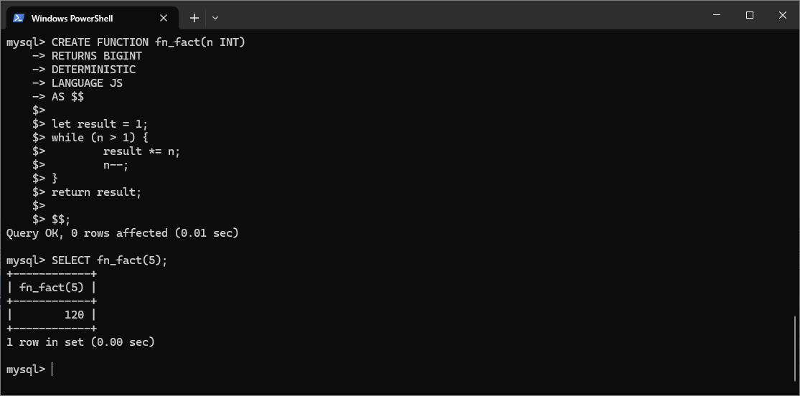

### Exemplo de criação de uma procedure em JS:

Ao criar uma procedure com JS programs, alguns pontos de atenção:

- O `returns` **não é usado** em `CREATE PROCEDURE`, ele é usado apenas em `CREATE FUNCTION`.  
- **Procedures não retornam valores diretamente**. Para retornar alguma informação, você deve usar os parâmetros `IN` e `OUT`.  
- Se você deseja que o valor seja retornado diretamente via `return`, então precisa criar uma **FUNCTION**.

### Exemplo de Procedure com parâmetros `IN` e `OUT`:

Criando uma procedure que verifica se é um número primo.

``` sql
CREATE PROCEDURE sp_is_prime(IN n INT, OUT is_prime BOOLEAN)
LANGUAGE JS
AS $$

if (n < 2) {
    is_prime = false;
} else {
    is_prime = true;
    for (let i = 2; i <= Math.sqrt(n); i++) {
        if (n % i === 0) {
            is_prime = false;
            break;
        };
    };
};

$$;
```

Para testar, chame a procedure:

```sql
CALL sp_is_prime(10, @resultado);
```

Depois, veja o resultado:

```sql
SELECT @resultado;
```

Screenshot:

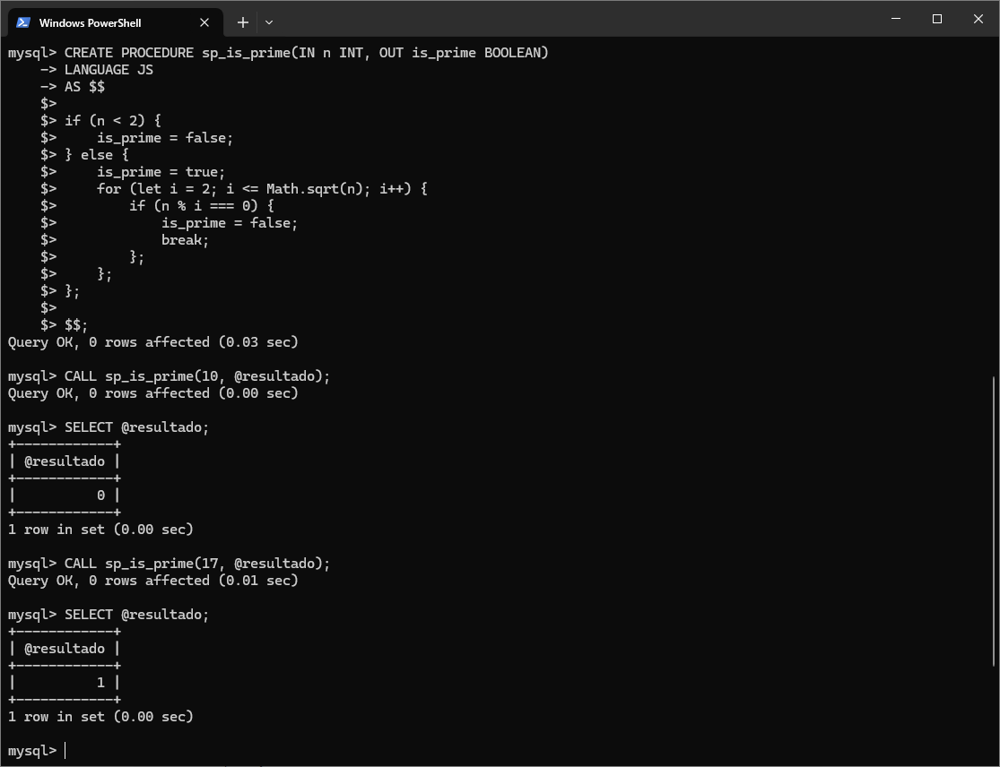


## Consultando rotinas JS com INFORMATION_SCHEMA.ROUTINES

A tabela `INFORMATION_SCHEMA.ROUTINES` no MySQL armazena informações sobre todas as rotinas criadas no banco de dados, como funções e procedures. Isso inclui também rotinas escritas em JavaScript utilizando a cláusula `LANGUAGE JS`.

Nessa tabela temos as seguintes informações:

- **routine_schema**: O banco de dados ao qual a rotina pertence.
- **routine_name**: O nome da rotina (função ou procedure).
- **routine_definition**: O código-fonte da rotina (por exemplo, o código JavaScript).
- **external_language**: A linguagem em que a rotina foi escrita (por exemplo, JS para rotinas JavaScript).

Exemplo de consulta que retorna todas as rotinas (funções e procedures) escritas em JavaScriptt (`LANGUAGE JS`):

```sql
SELECT
        routine_schema,
        routine_name,
        routine_definition,
        external_language
FROM
        INFORMATION_SCHEMA.ROUTINES
WHERE
        external_language='JS';
```

Exemplo de consulta para obter informações de uma função JavaScript chamada `fn_fact`:

```sql
SELECT
        routine_schema,
        routine_name,
        routine_definition,
        external_language
FROM
        INFORMATION_SCHEMA.ROUTINES
WHERE
        routine_name='fn_fact';
```     

Essas consultas retorna o esquema, nome, a definição completa do código JavaScript e indica que a linguagem externa é JS.

## Usando `console.log` e visualizando logs/erros de JS

### Criando uma procedure com `console.log`:

Você pode utilizar `console.log` dentro de rotinas JS para registrar informações de debug.

Exemplo:

```sql
CREATE PROCEDURE sp_console_log()
LANGUAGE JS
AS $$

	console.log("Hello, World!");
	
$$;
```

Depois de chamar a procedure, use as funções abaixo para visualizar os logs:

```sql
SELECT JS_GET_CONSOLE_LOG();
SELECT JS_GET_CONSOLE_LOG_JSON();
```

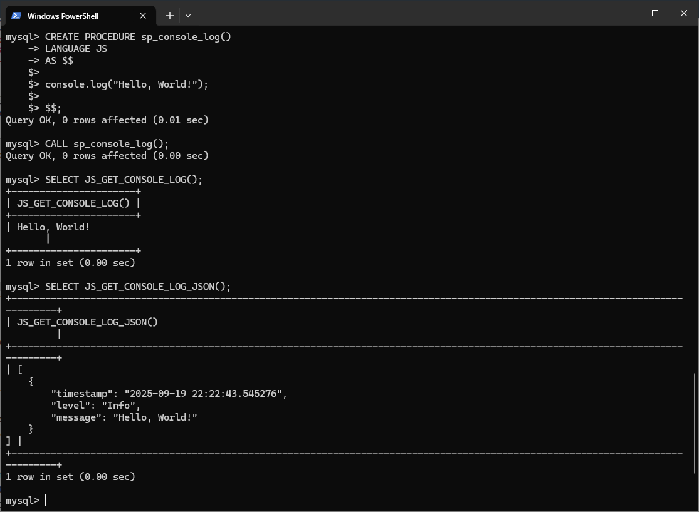

Para limpar o histórico de mensagens, use `JS_CLEAR_CONSOLE_LOG()`:

```sql
SELECT JS_CLEAR_CONSOLE_LOG();
```

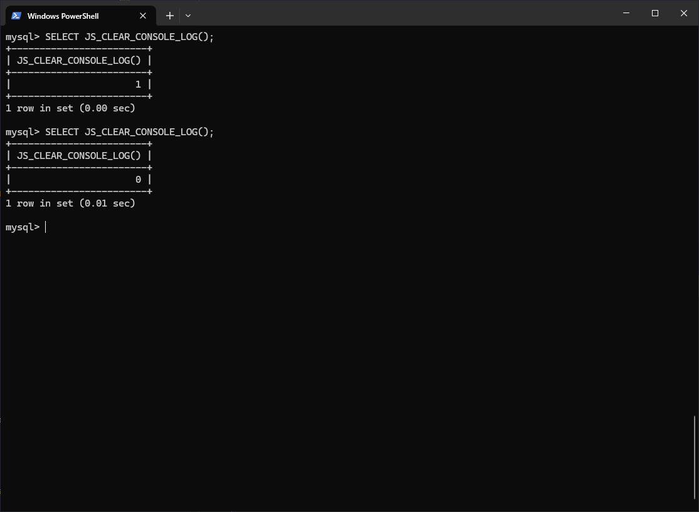

O retorno mostra a quantidade de mensagens apagadas.

Se executar novamente logo em seguida, o valor retornado será 0.

O exemplo abaixo mostra o resultado após executar a procedure 3 vezes:

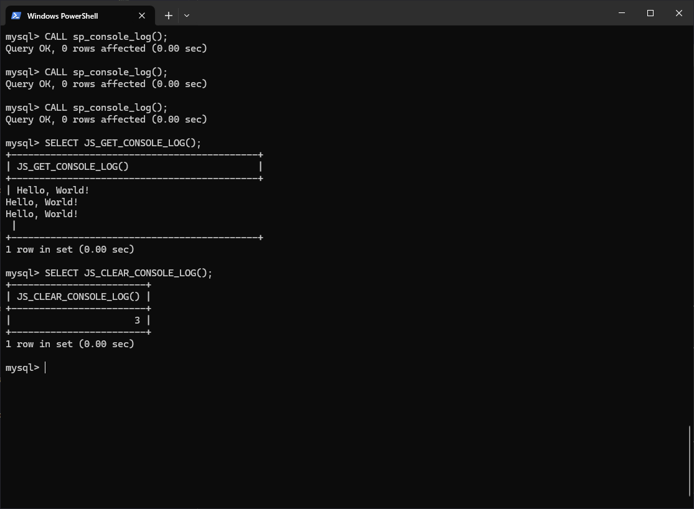

### Visualizando erros no JS:

Criei uma procedure que chama uma função que não existe:

```sql
CREATE PROCEDURE sp_error_test()
LANGUAGE JS
AS $$

	myFunction();
	
$$;
```

Ao executar essa procedure, um erro será exibido. Para visualizar o registro do erro, pode usar as funções abaixo:

```sql
SELECT JS_GET_LAST_ERROR();
SELECT JS_GET_LAST_ERROR_INFO();
```

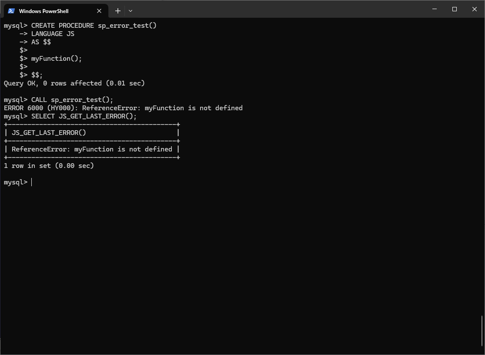

### Criando um erro personalizado:

Exemplo de procedure que calcula o tamanho de uma string. Se o parâmetro passado estiver vazio, um erro personalizado será lançado:

```sql
CREATE PROCEDURE sp_len(IN str VARCHAR(255), OUT len INT)
LANGUAGE JS
AS $$

if (str) {
	len = str.length;
} else {
	throw "Parameter is empty!";
}

$$;
```

Ao executar essa procedure com um parâmetro vazio, o erro personalizado será exibido:

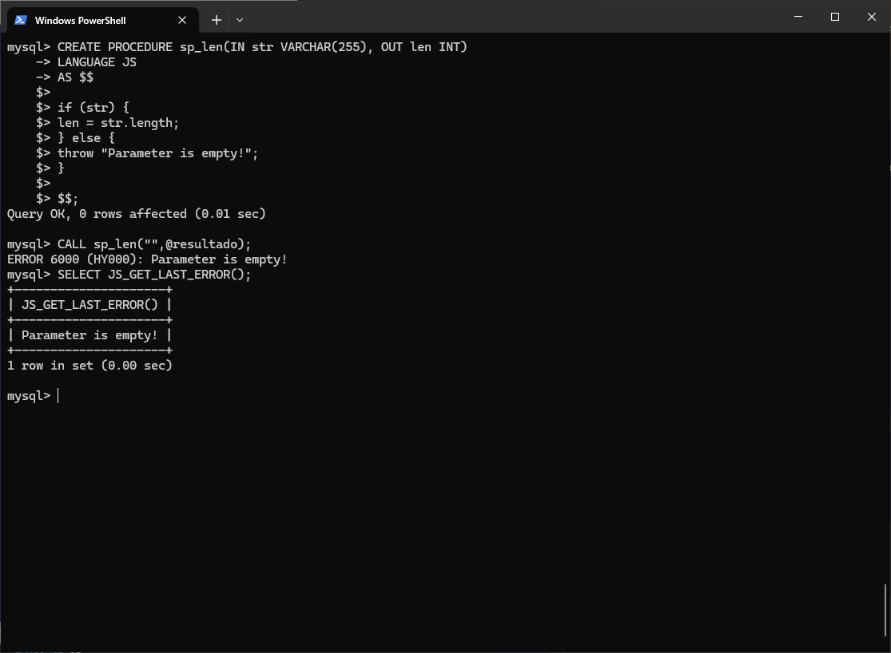

# Testes de performance

Chegamos a melhor parte do projeto!

Aqui vou demonstrar alguns testes de performance de funções e procedures usando JavaScript no MySQL. Também vou fazer comparações entre funções com SQL puro e JS programs, ver se existem diferenças de desempenho e em quais cenários cada abordagem se sai melhor.

Nos resultados dos testes abaixo, podem existir campos que chamei de **Speedup** e **Ganho**:

- Speedup: Indica quantas vezes o teste otimizado é mais rápido que o teste original.
```
Speedup = tempo_original / tempo_otimizado
```

- Ganho de Performance: Medida percentual da redução no tempo ou recurso consumido em comparação ao teste original.
```
Ganho = (tempo_original - tempo_otimizado) / tempo_original * 100
```

## Captalização de textos:

O objetivo do teste é capitalizar todo o texto, ou seja, deixar a primeira letra de cada palavra em maiúsculo.

Criamos duas funções para isso:
- Uma usando SQL puro  ([fn_sql_capitalize_words](sql_queries/fn_sql_capitalize_words.sql))
- Outra usando JavaScript (JS Programs) ([fn_js_capitalize_words](sql_queries/fn_js_capitalize_words.sql))

O intuito é comparar o desempenho e entender qual abordagem se sai melhor em termos de velocidade e eficiência.

No primeiro teste, utilizei o método [BENCHMARK](https://dev.mysql.com/doc/refman/8.4/en/select-benchmarking.html) do MySQL. Ele permite simular a execução de uma função N vezes, ajudando a estimar o custo e a velocidade de processamento.

Foi usado o texto `Lorem Ipsum is simply dummy text of the printing and typesetting industry.` como exemplo no teste.

```sql
-- Testando 1.000 vezes a função fn_sql_capitalize_words:
SELECT BENCHMARK(1000, fn_sql_capitalize_words('Lorem Ipsum is simply dummy text of the printing and typesetting industry.'));

-- Testando 1.000 vezes a função fn_js_capitalize_words:
SELECT BENCHMARK(1000, fn_js_capitalize_words('Lorem Ipsum is simply dummy text of the printing and typesetting industry.'));
```

Os testes foram realizados executando as funções 1.000, 10.000, 100.000 e 1.000.000 de vezes.  

Abaixo estão os resultados obtidos para cada quantidade de execuções:

```
+-----------+----------------------------+---------------------------+
| Iterações | fn_sql_capitalize_words(s) | fn_js_capitalize_words(s) |
+-----------+----------------------------+---------------------------+
|     1,000 |         0.094              |            0.031          |
|    10,000 |         0.781              |            0.125          |
|   100,000 |         6.094              |            1.390          |
| 1,000,000 |        60.453              |           13.610          |
+-----------+----------------------------+---------------------------+
```
> Você pode ver as query que utilizei neste teste aqui: [benchmark_capitalize_words](sql_queries/benchmark_capitalize_words.sql).

Para o segunto teste, usei o dataset [Disneyland Reviews](https://www.kaggle.com/datasets/arushchillar/disneyland-reviews/data).

O objetivo foi tentar simular um cenário real, com uma base de dados contendo textos em larga escala. Esse dataset possui mais de 42 mil registros.

Foi usado o [Performance Schema](sql_queries/performance_schema.sql) para ver o tempo gasto em cada query.

Resultados obtidos:

```
+----------------+-----------------------------------------------+------------------------+
|   FUNCTION     |                   SQL_TEXT                    |       TIMER_WAIT       |
+----------------+-----------------------------------------------+------------------------+
| JS Function    | SELECT fn_js_capitalize_words(Review_Text)    | 3.408.942.004.000      |
| SQL Function   | SELECT fn_sql_capitalize_words(Review_Text)   | 92.264.156.280.000     |
+----------------+-----------------------------------------------+------------------------+
```
> Você pode ver a query que utilizei neste teste aqui: [review_text](sql_queries/review_text.sql).

A função em JS programs levou pouco mais de 3 segundos, enquanto a mesma função em SQL demorou mais de 92 segundos para processar uma base com 42.656 registros.

No teste com BENCHMARK, demonstrou que o ganho de performance se manteve constante com o número crescente de interações.

No teste com a base Disneyland Reviews, a função com JS Programs demonstrou ser muito mais rápida em comparação à função em SQL puro.

| Teste              | Nº de iterações/registros  | SQL (s) | JS (s) | Speedup (x) | Ganho (%) |
|--------------------|----------------------------|---------|--------|-------------|-----------|
| Bechmark           | 1.000                      |  0.094  | 0.031  | 3.03x       | 67.02%    |
| Bechmark           | 10.000                     |  0.781  | 0.125  | 6.25x       | 83.99%    |
| Bechmark           | 100.000                    |  6.094  | 1.390  | 4.39x       | 77.19%    |
| Bechmark           | 1.000.000                  | 60.453  | 13.610 | 4.44x       | 77.49%    |
| Disneyland Reviews | 42.656                     | 92.264  | 3.409  | 27.06x      | 96.31%    |

*(s) = tempo em segundos*

Gráfico de linhas comparando o tempo de execução (em segundos) entre as funções SQL e JS no teste do BENCHMARK:

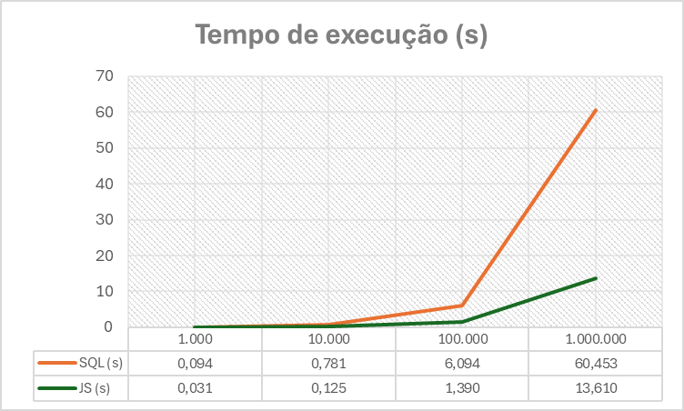

Gráfico de barras comparando o tempo de execução (em segundos) entre as funções SQL e JS no teste realizado com a base `Disneyland Reviews`:

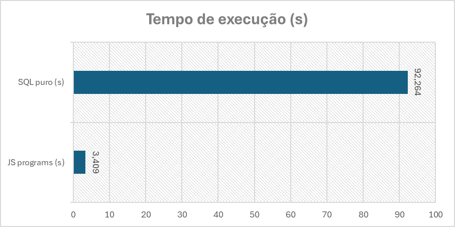

**Conclusões:**

- A função em JavaScript foi melhor em todos os testes.
- O ganho de performance com JS Programs ficou entre 67% e 96%.
- Nos testes de BENCHMARK, a função com JS Programs ficou entre 3x e 6x mais rápida.
- No cenário real, a função em JS foi 27 vezes mais rápida que o SQL.

## Comparativo entre funções UPPER, LENGTH e TO_BASE64

Aproveitando os registros da base Disneyland Reviews, realizei testes comparativos entre funções nativas do SQL (como `UPPER`, `LENGTH` e `TO_BASE64`) e versões equivalentes implementadas em JS Programs. O objetivo foi avaliar o desempenho e a eficiência das funções JavaScript em relação às funções SQL tradicionais.

Abaixo segue as funções criadas em JS programs para esse teste:

- [fn_js_base64](sql_queries/fn_js_base64.sql)
- [fn_js_length](sql_queries/fn_js_length.sql)
- [fn_js_upper_case](sql_queries/fn_js_upper_case.sql)

Obtive os seguintes resultados dos testes, fiz usando a base da Disneyland Reviews e um BENCHMARK simulando 1.000.000 registros.

Comparativo da função UPPER:
```
+------------------------------------------------------------------+---------------------+
| Query                                                            | Tempo decorrido (s) |
+------------------------------------------------------------------+---------------------+
| SELECT UPPER(Review_Text) FROM disneyland_reviews                | 0.703               |
| SELECT fn_js_upper_case(Review_Text) FROM disneyland_reviews     | 1.516               |
+------------------------------------------------------------------+---------------------+
| SELECT BENCHMARK(1.000.000, UPPER('Lorem Ipsum ...'))            | 0.282               |
| SELECT BENCHMARK(1.000.000, fn_js_upper_case('Lorem Ipsum ...')) | 8.515               |
+------------------------------------------------------------------+---------------------+
```

Comparativo da função LENGTH:
```
+---------------------------------------------------------------+---------------------+
| Query                                                         | Tempo decorrido (s) |
+---------------------------------------------------------------+---------------------+
| SELECT LENGTH(Review_Text) FROM disneyland_reviews            | 0.031               |
| SELECT fn_js_length(Review_Text) FROM disneyland_reviews      | 0.547               |
+---------------------------------------------------------------+---------------------+
| SELECT BENCHMARK(1.000.000, LENGTH('Lorem Ipsum ...'))        | 0.015               |
| SELECT BENCHMARK(1.000.000, fn_js_length('Lorem Ipsum ...'))  | 6.922               |
+---------------------------------------------------------------+---------------------+
```

Comparativo da função TO_BASE64:
```
+---------------------------------------------------------------+---------------------+
| Query                                                         | Tempo decorrido (s) |
+---------------------------------------------------------------+---------------------+
| SELECT LENGTH(Review_Text) FROM disneyland_reviews            | 0.031               |
| SELECT fn_js_length(Review_Text) FROM disneyland_reviews      | 0.547               |
+---------------------------------------------------------------+---------------------+
| SELECT BENCHMARK(1.000.000, LENGTH('Lorem Ipsum ...'))        | 0.015               |
| SELECT BENCHMARK(1.000.000, fn_js_length('Lorem Ipsum ...'))  | 6.922               |
+---------------------------------------------------------------+---------------------+
```

> Foi usado o texto `Lorem Ipsum is simply dummy text of the printing and typesetting industry.` como exemplo no teste no BENCHMARK.

Tabela detalhada:

| Função          | Teste              | Tempo SQL (s) | Tempo JS (s) | Speedup (x) | Ganho (%) |
| --------------- | ------------------ | ------------- | ------------ | ----------- | --------- |
| UPPER           | Disneyland Reviews | 0.703         | 1.516        | 2.16x       | 53.7 %    |
| UPPER           | Benchmark          | 0.282         | 8.515        | 30.2x       | 96.7 %    |
| LENGTH          | Disneyland Reviews | 0.031         | 0.547        | 17.6x       | 94.3 %    |
| LENGTH          | Benchmark          | 0.015         | 6.922        | 461.5x      | 99.8 %    |
| TO_BASE64       | Disneyland Reviews | 0.797         | 2.297        | 2.88x       | 65.3 %    |
| TO_BASE64       | Benchmark          | 0.093         | 10.641       | 114.5x      | 99.1 %    |

*(s) = tempo em segundos*

Visualizando em um gráfico de colunas, fica claro a diferença de tempo gasto entre as funções de SQL nativas contra JS programs:

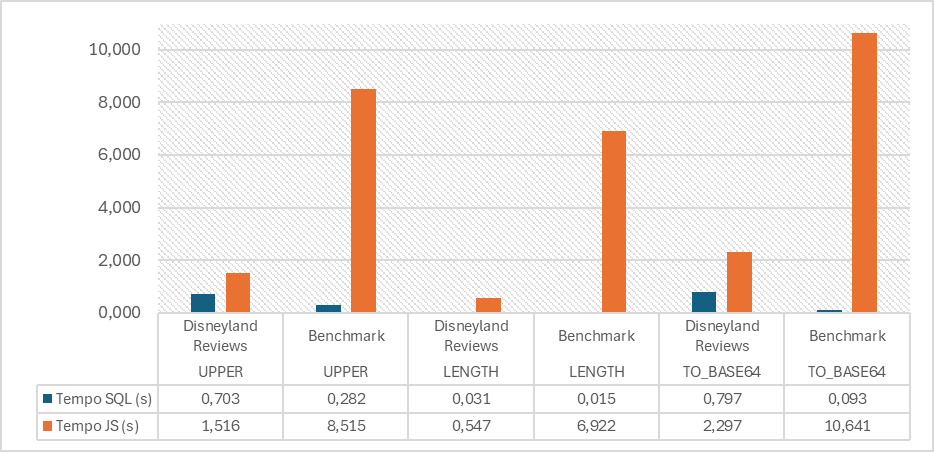

Analisando os resultados desses testes, foi observado que:

- As funções internas do MySQL (como UPPER, LENGTH e TO_BASE64) são altamente otimizadas, com praticamente nenhum overhead de execução.
- As funções em JS Programs possuem overhead adicional devido à comunicação com o motor JavaScript, tornando operações simples mais lentas em comparação às funções nativas.
- Para operações simples e já disponíveis no MySQL, as funções nativas oferecem mais praticidade e velocidade.
- JS Programs só compensam em tarefas complexas ou para operações que não possuem equivalente nativo em SQL.

## Criando função de ULID

Resumidamente, ULID é um tipo de identificador único, parecido com o UUID, mas com uma vantagem: ele é ordenável. Ou seja, se eu gerar um ULID agora e outro daqui a alguns instantes, o segundo vai aparecer depois do primeiro quando for ordenado alfabeticamente. Um ULID tem 128 bits e pode ser representado como uma string de 26 caracteres.

Ele é dividido em duas partes:

- Primeiros 10 caracteres: representam o timestamp (quando foi gerado).
- Últimos 16 caracteres: são valores aleatórios, garantindo que não tenha colisão.

O MySQL não tem uma função nativa pra gerar ULID, então eu criei duas alternativas:

- Uma função que gera ULID usando SQL puro ([fn_sql_ulid](sql_queries/fn_sql_ulid.sql))
- Outra função que gera ULID usando JavaScript (JS Programs) dentro do MySQL ([fn_js_ulid](sql_queries/fn_js_ulid.sql))

A ideia é bem simples: testar se a geração do ULID via JavaScript é mais rápida do que a geração via SQL.

Fiz o teste utilizando o `BENCHMARK`, indo de 1.000 até 1.000.000 interações.

Resultados obtidos:

```
+---------------------------------------------+ 
|                  BENCHMARK                  |
+-----------+-----------------+---------------+ 
| Iterações | fn_sql_ulid (s) | fn_js_ulid(s) |
+-----------+-----------------+---------------+ 
| 1.000     | 0,110           | 0,031         |
| 10.000    | 1,234           | 0,109         |
| 100.000   | 9,657           | 0,953         |
| 1.000.000 | 108,344         | 7,609         |
+-----------+-----------------+---------------+ 
```
*(s) = tempo em segundos*

> Você pode ver a query que utilizei neste teste do `BENCHMARK` aqui: [benchmark_ulid](sql_queries/benchmark_ulid.sql).

E também testei utilizando a base [Employees Sample Database](https://dev.mysql.com/doc/employee/en/) para simular a adição de um campo ULID em um cenário real.

Foi adicionado um campo ``ulid`` na tabela ``employees``.

```sql
ALTER TABLE `employees`.`employees` ADD COLUMN `ulid` CHAR(26) NULL;
```

Depois fiz a atualização do campo:

```sql
-- Atualizando com a função SQL:
UPDATE
	employees
SET
	ulid = fn_sql_ulid()
WHERE
	ulid IS NULL;

-- Atualizando com a função JS programs:
UPDATE
	employees
SET
	ulid = fn_js_ulid()
WHERE
	ulid IS NULL;
```

> A tabela `employees` possui 300.024 registros.

Resultados obtidos:

```
+----------------------------------------------------+
|                  UPDATE employees                  |
+-----------------+-----------------+----------------+
| Linhas Afetadas | fn_sql_ulid (s) | fn_js_ulid (s) |
+-----------------+-----------------+----------------+
| 300.024         | 47,047          | 14,016         |
+-----------------+-----------------+----------------+
```
*(s) = tempo em segundos*

Depois dessa bateria de testes, deixo os resultados abaixo:

| Cenário          | Iterações / Registros | Tempo SQL (s) | Tempo JS (s) | Speedup (x) | Ganho (%) |
| ---------------- | --------------------- | ------------- | ------------ | ----------- | --------- |
| BENCHMARK        | 1.000                 | 0,110         | 0,031        | 3,55x       | 71,8%     |
| BENCHMARK        | 10.000                | 1,234         | 0,109        | 11,32x      | 91,2%     |
| BENCHMARK        | 100.000               | 9,657         | 0,953        | 10,13x      | 90,1%     |
| BENCHMARK        | 1.000.000             | 108,344       | 7,609        | 14,24x      | 93,0%     |
| UPDATE employees | 300.024               | 47,047        | 14,016       | 3,36x       | 70,2%     |

Gráfico de linhas com as comparações de tempo de execução do teste de BENCHMARK:

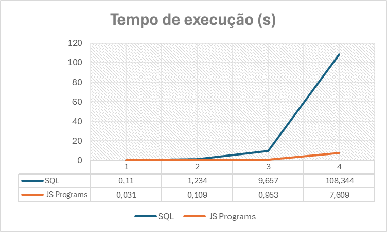

Gráfico de barras com as comparações de tempo de execução do teste de UPDATE na tabela `employyes`:

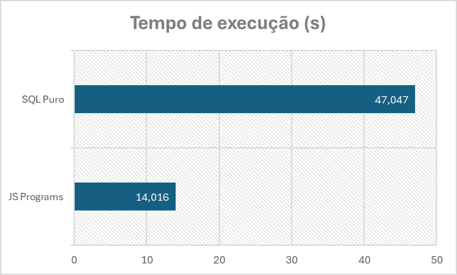

**Conclusões:**

Nos testes com BENCHMARK, a função em **JS programs** mostrou ganhos consistentes e consideraveis, chegando a 14 vezes mais rápido em 1 milhão de iterações.

Em cenário real de UPDATE em tabela `employees`, o ganho foi menor utilizando a função em **JS programs**, mas ainda expressivo: cerca de 70% de ganho de perfomance, sendo um pouco mais de 3 vezes mais rápido.

Isso mostra que o overhead de chamadas **SQL puras** é maior para cálculos complexos (nesse exemplo criar ULID), e o motor JS demosntrou nesse teste set mais eficiente para essa lógica.

## Realizando INSERT em loop usando a função ULID

Neste teste, realizei inserções em loop utilizando funções de ULID. Meu objetivo é verificar se existem diferenças de performance entre usar a função SQL e a função JS para inserir registros em loops.

Primeiro, foi criada uma tabela para armazenar os registros: [tb_ulid](sql_queries/tb_ulid.sql).

Em seguida, criei duas procedures para realizar os inserts em loop:

- [sp_insert_ulid_sql](sql_queries/sp_insert_ulid_sql.sql) - usando a função em SQL puro.
- [sp_insert_ulid_js](sql_queries/sp_insert_ulid_js.sql) - usando a função em JavaScript (JS Programs).

As inserções foram realizadas em diferentes volumes, variando de 100 até 100.000 registros.

A query utilizada para realizar os testes está disponível aqui: [call_insert_tb_ulid](sql_queries/call_insert_tb_ulid.sql).

Os resultados obtidos foram bem interessantes, segue abaixo:

| Iterações | Tempo SQL (s) | Tempo JS (s) | Speedup (SQL/JS) | Ganho (SQL/JS) |
| --------- | ------------- | ------------ | ---------------- | -------------- |
| 100       | 0.484         | 0.406        | 1.19x            | 16.1%          |
| 500       | 2.016         | 1.656        | 1.22x            | 17.9%          |
| 1.000     | 4.875         | 3.344        | 1.46x            | 31.4%          |
| 5.000     | 20.641        | 17.188       | 1.20x            | 16.7%          |
| 10.000    | 45.047        | 31.000       | 1.45x            | 31.2%          |
| 50.000    | 205.125       | 182.063      | 1.13x            | 11.2%          |
| 100.000   | 361.109       | 372.203      | 0.97x            | -3.1%          |

*(s) = tempo em segundos*

Visualizando em um gráfico de linhas:

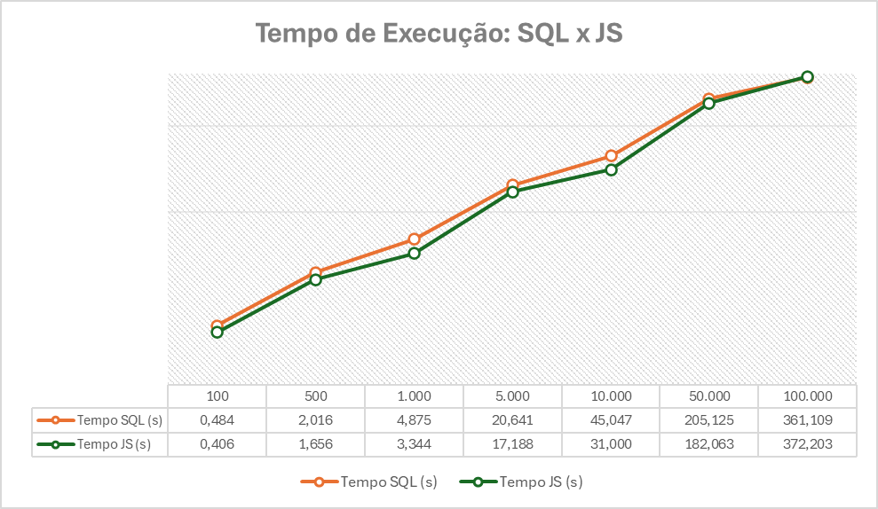

**Conclusões:**

- A diferença entre as funções SQL e JS na operação de INSERT não é tão significativa em comparação ao UPDATE.
- A instrução de UPDATE tende a usar mais CPU, enquanto o INSERT em loop é I/O-bound (escritas em disco, transações repetidas), minimizando o impacto da função ULID (CPU-bound). Ganhos com a função JS aparecem mais em volumes médios (100-10k inserts).
- O custo de geração do ULID (SQL ou JS) é relativamente pequeno, o que torna o impacto da função quase irrelevante nos volumes pequenos e médios.
- O ganho da função JS sobre SQL ficou entre 11% e 31% na maior parte dos testes.
- Em volumes baixos a médios (100 a 10k), a função JS teve vantagem consistente.
- Em volumes mais altos (50k a 100k), a diferença fica equilibrada. Em 100k inserts, o SQL superou o JS (pouco mais de 3%), mostrando que em volumes mais altos o SQL pode ser ligeiramente melhor devido a overheads no motor JS ou variações de I/O.

## Calculando dados em JSON

Foi utilizado nesse teste o dataset [Flight Data](https://www.tablab.app/json/sample), ele possui 1 milhão de registros.

Exemplo de um JSON do databse:

```json
{
    "FL_DATE":"2006-01-01",
    "DEP_DELAY":5,
    "ARR_DELAY":19,
    "AIR_TIME":350,
    "DISTANCE":2475,
    "DEP_TIME":9.083333,
    "ARR_TIME":12.483334
}
```

O objetivo foi realizar alguns testes simples, como calcular:

- Tempo total de atraso dos voos
- Velocidade média de cada voo

Para isso, foram criadas duas funções JS programs:

- [fn_js_flight_total_delay](sql_queries/fn_js_flight_total_delay.sql)
- [fn_js_flight_duration_minutes](sql_queries/fn_js_flight_duration_minutes.sql)

A intenção é comparar o desempenho e a praticidade das funções nativas do MySQL com as funções desenvolvidas em JS programs para análise de dados em formato JSON.

### Tempo total de atraso dos voos

Para calcular o tempo total, usei a seguinte fórmula: `ARR_DELAY - DEP_DELAY`.

As querys SQL usadas nesse teste estão aqui: [query_flight_total_delay](sql_queries/query_flight_total_delay.sql).

Foi feito testes usando `LIMIT` de 100 a 1.000.000 registros, comparando o desempenho entre a função SQL nativa e a função com JS programs.

Resultados dos testes:

| Registros | Tempo SQL (s) | Tempo JS (s) | Speedup | Ganho (%) |
| --------- | ------------- | ------------ | ------- | --------- |
|       100 |         0.000 |        0.000 |       - |         - |
|     1.000 |         0.016 |        0.000 |       - |         - |
|    10.000 |         0.016 |        0.250 |   15.6x |     93.6% |
|   100.000 |         0.360 |        2.000 |    5.6x |     82.0% |
| 1.000.000 |         3.219 |       24.516 |    7.6x |     86.9% |

Visualizando em um gráfico de linhas:

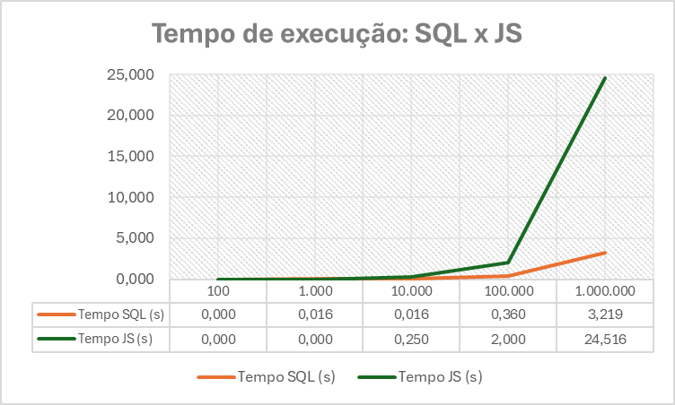

- Até 1.000 registros, não teve diferença de performance entre a função com SQL com JS programs. Os tempos são praticamente instantâneos.
- A partir de 10.000 registros, o SQL nativo se mostra consistentemente superior, com ganhos acima de 80%.
- No maior volume, 1 milhão de registros, o SQL foi mais de 7 vezes mais rápido que a execução via função JS programs.

### Duração dos voos

Para calcular a duração dos voos, foi utilizada a seguinte lógica: `ARR_TIME - DEP_TIME`.

Caso o resultado seja menor que zero, é adicionado 24 horas ao cálculo, para corrigir situações em que o voo ultrapassa a meia-noite.

Por fim, o valor é multiplicado por 60 para converter o resultado em minutos.

As querys SQL usadas nesse teste estão aqui: [query_flight_duration_minutes](sql_queries/query_flight_duration_minutes.sql).

Foi feito testes usando `LIMIT` de 100 a 1.000.000 registros, comparando o desempenho entre a função SQL nativa e a função com JS programs.

Resultados dos testes:

| Registros | Tempo SQL (s) | Tempo JS (s) | Speedup | Ganho (%) |
| --------- | ------------- | ------------ | --------|---------- |
|       100 |         0.000 |        0.000 |       - |         - |
|     1.000 |         0.016 |        0.000 |       - |         - |
|    10.000 |         0.062 |        0.250 |    4.0x |     75.2% |
|   100.000 |         0.750 |        2.172 |    2.9x |     65.5% |
| 1.000.000 |         6.079 |       23.453 |    3.9x |     74.1% |

Visualizando em um gráfico de linhas:

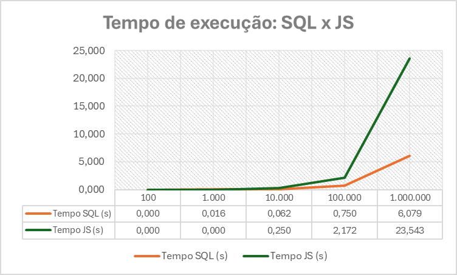

- Em volumes pequenos, 100 até 1.000 registros, não houve diferença de perfomrance. O tempo para ambos os testes  SQL e JS programs, foram o mesmo.
- Para 10.000 até 100.000 registros, o SQL foi cerca de 3 a 4 vezes mais rápido que a função JS.
- Em 1 milhão de registros, o SQL finalizou em 6 segundos, enquanto o JS programs levou 23 segundos. Uma diferença de 74% de ganho de performance.

### Conclusão:

- Em volumes pequenos, até 10.000 registros, os testes não apresentaram diferença significativa de tempo nos resultados.
- A partir de volumes maiores, de 100.000 registros ou mais, a função nativa do SQL mostrou ser mais eficiente.
- As funções nativas SQL (JSON_VALUE) foram muito mais eficientes do que funções em JavaScript no MySQL, principalmente quando o volume de dados cresce.
- Mesmo usando lógicas condicionais no SQL (CASE WHEN), o mesmo se manteve com um bom desempenho.
- As funções JS exigem execução do motor V8, conversão de tipos e chamadas externas para cada linha, o que impactou a performance.

## Validação de emails com REGEX

O objetivo deste teste é comparar a performance de validação de endereços de e-mail utilizando uma expressão regular complexa (baseada no padrão RFC 5322) entre uma Stored Function em SQL puro (`REGEXP`) e uma Stored Function em JavaScript (motor V8).

Para isso, foram criadas duas funções equivalentes:
- Uma usando SQL puro ([fn_validate_email_sql](sql_queries/fn_validate_email_sql.sql))
- Outra usando JavaScript (JS Programs) ([fn_validate_email_js](sql_queries/fn_validate_email_js.sql))

Os testes foram executados utilizando o método `BENCHMARK` (variando de `1.000` a `1.000.000` de iterações) em três cenários distintos de entrada:
- **Cenário A — Validação com sucesso (`teste@dominio.com`):** E-mail válido padrão que percorre toda a estrutura da expressão regular até confirmar o casamento completo.
- **Cenário B — Falha imediata (`teste.com`):** String curta sem o caractere `@`, onde o motor descarta a validação logo após o primeiro grupo.
- **Cenário C — Falha no final (`teste@xxx.....com`):** String longa (~110 caracteres) que parece válida durante quase toda a leitura, mas falha apenas no final por conter dois pontos seguidos (`..com`), exigindo avaliação completa da cadeia.

> Você pode ver as queries utilizadas neste teste aqui: [benchmark_validate_email](sql_queries/benchmark_validate_email.sql).

Resultados detalhados por cenário:

| Função         | Teste                                  | Tempo SQL (s) | Tempo JS (s) | Speedup (x) | Ganho (%) |
| -------------- | -------------------------------------- | ------------- | ------------ | ----------- | --------- |
| VALIDATE_EMAIL | Benchmark 1.000 (`teste@dominio.com`)  |         0.016 |        0.000 |    > 16.0x* |  ~100.0%* |
| VALIDATE_EMAIL | Benchmark 1.000 (`teste.com`)          |         0.016 |        0.000 |    > 16.0x* |  ~100.0%* |
| VALIDATE_EMAIL | Benchmark 1.000 (`teste@xxx.....com`)  |         0.016 |        0.016 |       1.00x |      0.0% |
| VALIDATE_EMAIL | Benchmark 10.000 (`teste@dominio.com`) |         0.203 |        0.031 |       6.55x |     84.7% |
| VALIDATE_EMAIL | Benchmark 10.000 (`teste.com`)         |         0.204 |        0.016 |      12.75x |     92.2% |
| VALIDATE_EMAIL | Benchmark 10.000 (`teste@xxx.....com`) |         0.219 |        0.032 |       6.84x |     85.4% |
| VALIDATE_EMAIL | Benchmark 100.000 (`teste@dominio.com`)|         2.015 |        0.203 |       9.93x |     89.9% |
| VALIDATE_EMAIL | Benchmark 100.000 (`teste.com`)        |         2.015 |        0.218 |       9.24x |     89.2% |
| VALIDATE_EMAIL | Benchmark 100.000 (`teste@xxx.....com`)|         2.187 |        0.234 |       9.35x |     89.3% |
| VALIDATE_EMAIL | Benchmark 1.000.000 (`teste@dominio.com`)|      20.516 |        2.046 |      10.03x |     90.0% |
| VALIDATE_EMAIL | Benchmark 1.000.000 (`teste.com`)      |        20.891 |        2.047 |      10.21x |     90.2% |
| VALIDATE_EMAIL | Benchmark 1.000.000 (`teste@xxx.....com`)|      21.859 |        2.265 |       9.65x |     89.6% |

*\*Nos testes de 1.000 iterações com `0.000s`, a execução em JS ficou abaixo do limiar de precisão de 1 ms do console, representando tempo de resposta quase instantâneo.*

### Validação de E-mail: Média Geral dos Testes

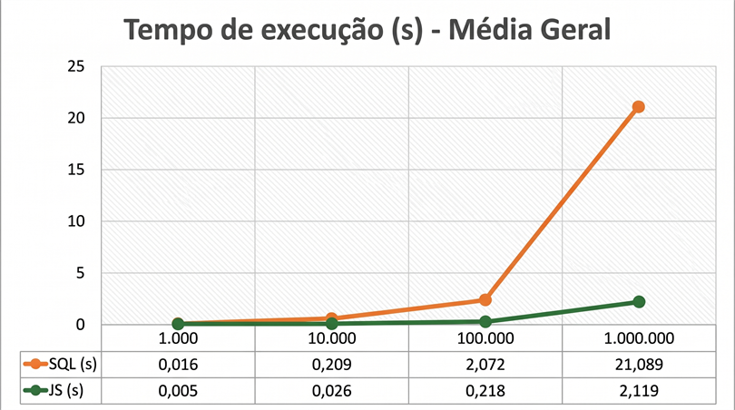

Consolidando a média dos três cenários (sucesso, falha imediata e falha no final) para cada volume de iterações:

| Iterações | Tempo SQL (s) | Tempo JS (s) | Speedup (x) | Ganho (%) |
| :--- | :--- | :--- | :--- | :--- |
| 1.000 | 0.016 | 0.005 | 3.2x | 68.8% |
| 10.000 | 0.209 | 0.026 | 8.0x | 87.6% |
| 100.000 | 2.072 | 0.218 | 9.5x | 89.5% |
| 1.000.000 | 21.089 | 2.119 | 10.0x | 90.0% |

*(s) = tempo em segundos*

**Conclusões:**

- **Superioridade absoluta do JS com Regex:** Em todos os volumes e cenários avaliados, a função em **JS Programs** superou com folga a Stored Function em SQL puro (`REGEXP`), estabilizando em **10x mais rápida** (redução de **90%** no tempo de execução) em 1.000.000 de iterações.
- **Eficiência do motor V8 (Irregexp JIT):** O Google V8 utiliza o motor *Irregexp*, que compila expressões regulares diretamente para código de máquina altamente otimizado. Já na função SQL (`BEGIN ... RETURN (p_email REGEXP ...) END`), há o custo do interpretador procedural do MySQL somado à avaliação da engine ICU a cada invocação.
- **Resiliência no pior caso (Cenário C):** Mesmo ao validar strings longas que falham apenas nos últimos caracteres (`teste@xxx.....com`), onde o motor precisa percorrer praticamente toda a cadeia, o JS manteve sua vantagem: em **1 milhão de execuções**, o JS concluiu em **2,26 segundos** contra **21,85 segundos** do SQL.
- **Caso de uso ideal para JS no banco:** Esse resultado comprova na prática a proposta arquitetural da Percona — validações complexas de formato e regras baseadas em Regex dentro de rotinas são um dos melhores cenários para adotar `LANGUAGE JS` no Percona Server 8.4 LTS.

# Erros comuns

Deixo aqui alguns problemas que enfrentei durante este projeto, assim, caso alguém passe pela mesma dificuldade, pode consultar as soluções abaixo.

## Erro ao conectar via GUI:

Caso, ao tentar conectar ao banco via alguma GUI, como o **DBeaver**, você receba um erro semelhante a este:

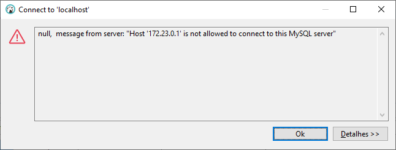

> "Host '172.23.0.1' is not allowed to connect to this MySQL server"

Isso significa que o usuário que você está tentando usar **não tem permissão** para se conectar a partir do host que você está usando.  

No exemplo acima, o MySQL recebeu a conexão do IP do host Docker (`172.23.0.1`), mas o usuário `root` não está autorizado a se conectar de lá.

Com a configuração atual do `docker-compose.yml` e `init.sql`, os usuários `root`@`%` e `dev`@`%` já são criados com acesso remoto liberado. Caso precise liberar manualmente em outra instância, execute no MySQL:

```sql
CREATE USER IF NOT EXISTS 'root'@'%' IDENTIFIED BY 'rootpassword';
GRANT ALL PRIVILEGES ON *.* TO 'root'@'%' WITH GRANT OPTION;
FLUSH PRIVILEGES;
```

## Erro: "This function has none of DETERMINISTIC":

Se você tentar criar uma função no MySQL e receber:

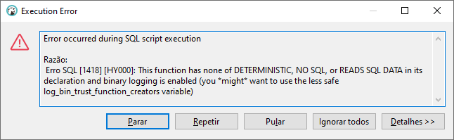

> ERROR 1418 (HY000): This function has none of DETERMINISTIC, NO SQL, or READS SQL DATA in its declaration and binary logging is enabled (you might want to use the less safe log_bin_trust_function_creators variable)

É porque o binlog (registro de alterações do banco) está ativo e o MySQL quer que você diga se a função é determinística ou se lê/modifica dados.

Pode solucionar usando um dos métodos abaixo:

1. Adicionar as marcações na função:

- DETERMINISTIC ou NOT DETERMINISTIC
- NO SQL, READS SQL DATA ou MODIFIES SQL DATA

2. Ou, se você não quiser declarar DETERMINISTIC/NO SQL, pode permitir que qualquer função seja criada mesmo com binlog ativo:

```sql
SET GLOBAL log_bin_trust_function_creators = 1;
```

Isso permite criar funções sem marcar determinismo ou tipo de SQL.

## Erro de privilégio CREATE_JS_ROUTINE:

Ao tentar criar uma função ou procedure, recebeu esse erro:

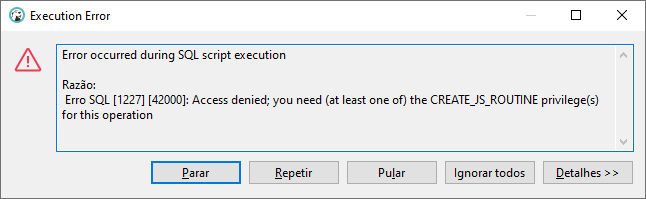

> ERROR 1227 (42000): Access denied; you need (at least one of) the CREATE_JS_ROUTINE privilege(s) for this operation.

Esse erro indica que o usuário atual não possui o privilégio CREATE_JS_ROUTINE necessário para criar stored functions ou procedures em JavaScript no Percona Server for MySQL 8.4.

Para conceder o privilégio, é necessário utilizar um usuário com permissões administrativas (por exemplo, `root`).

Execute o comando abaixo para conceder os privilégios ao seu usuário:

```sql
GRANT CREATE_JS_ROUTINE, CREATE ROUTINE ON *.* TO 'seu_usuario'@'localhost';
FLUSH PRIVILEGES;
```

## Problema ao importar arquivo no MySQL:

Ao tentar importar um arquivo para o MySQL, como por exemplo um CSV, você pode receber o seguinte erro:

```
Error Code: 1290. The MySQL server is running with the --secure-file-priv option
```

Esse erro significa que o MySQL está rodando com a variável `secure_file_priv` habilitada.

Essa variável restringe os diretórios permitidos para importar/exportar arquivos (`LOAD DATA INFILE`, `SELECT ... INTO OUTFILE` e entre outros).

Basicamente, você está tentando carregar um arquivo em um local que o MySQL considera inseguro.

Para descobrir qual é o diretório seguro, execute:

```sql
SHOW VARIABLES LIKE 'secure_file_priv';
```

Exemplo de resultado:

```
+------------------+-----------------------+
|  Variable_name   |         Value         |
+------------------+-----------------------+
| secure_file_priv | /var/lib/mysql-files/ |
+------------------+-----------------------+
```

No meu caso, resolvi o problema movendo o arquivo para o diretório seguro, que no exemplo acima é `/var/lib/mysql-files/`.

## Erro no boot do container: "Another process with pid ... is using unix socket file":

Ao subir o container com um script em `/docker-entrypoint-initdb.d/init.sql`, caso o container entre em loop de reinicialização (`exited with code 1 (restarting)`) exibindo nos logs:

```text
[ERROR] [MY-011300] [Server] Plugin mysqlx reported: 'Setup of socket: '/var/lib/mysql/mysqlx.sock' failed, another process with PID 57 is using UNIX socket file'
[ERROR] [MY-010259] [Server] Another process with pid 57 is using unix socket file.
[ERROR] [MY-010268] [Server] Unable to setup unix socket lock file.
[ERROR] [MY-010119] [Server] Aborting
```

**Por que isso acontece?**

1. No primeiro boot, o `docker-entrypoint.sh` sobe um processo temporário do MySQL (ex.: `PID 57`) apenas para executar os scripts dentro de `/docker-entrypoint-initdb.d/` (como o `init.sql`).
2. Se **qualquer comando SQL dentro do `init.sql` falhar** (por exemplo, tentar rodar um `CREATE FUNCTION` sem declarar `DETERMINISTIC` quando o `log_bin` está ativo, gerando o `ERROR 1418`), o script de entrypoint interrompe a inicialização imediatamente com erro.
3. Como o entrypoint aborta abruptamente, o `mysqld` temporário (`PID 57`) não é encerrado de forma limpa e deixa os arquivos de lock (`mysql.sock.lock` e `mysqlx.sock.lock`) gravados dentro do volume `/var/lib/mysql`.
4. Quando o Docker tenta reiniciar o container (`restart: unless-stopped`), o banco encontra o volume já populado com o lock órfão do `PID 57` e aborta repetidamente.

**Como resolver:**

1. Certifique-se de que as funções no `init.sql` tenham `DETERMINISTIC` (ou `SET GLOBAL log_bin_trust_function_creators = 1;` / `--log-bin-trust-function-creators=1` no `docker-compose.yml`).
2. Remova o container e o volume corrompido pela inicialização incompleta e suba novamente:

```bash
docker compose down -v
docker compose up -d
```